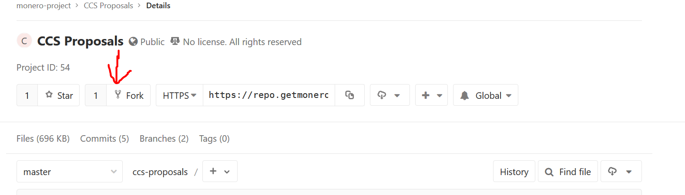
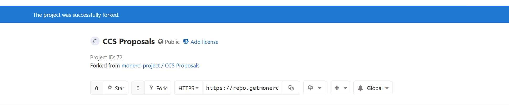
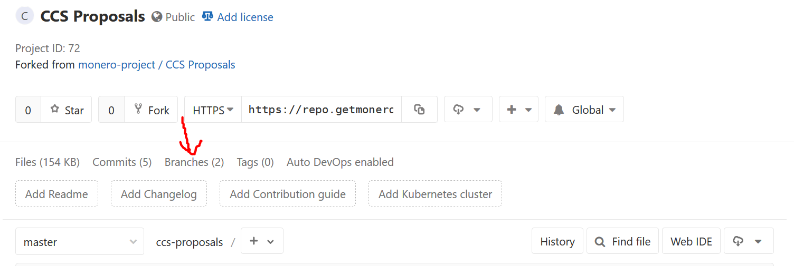
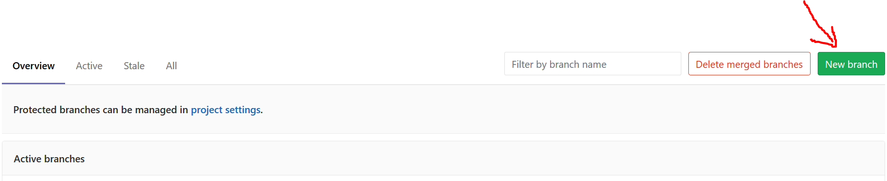
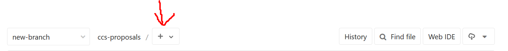
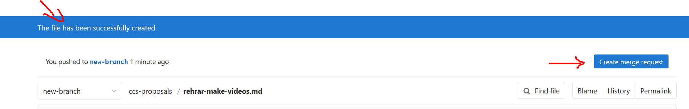
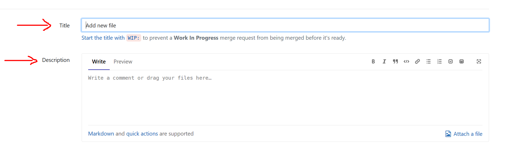
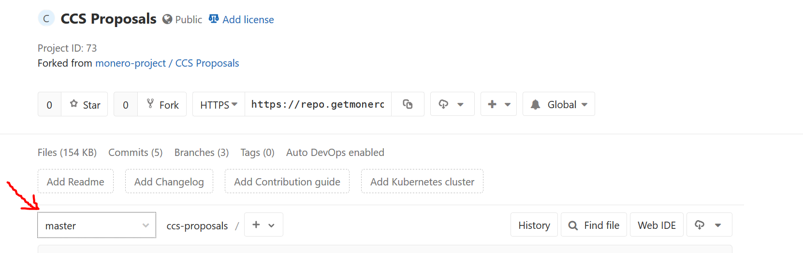
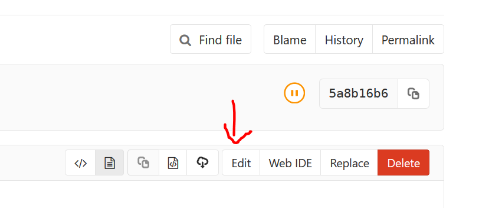
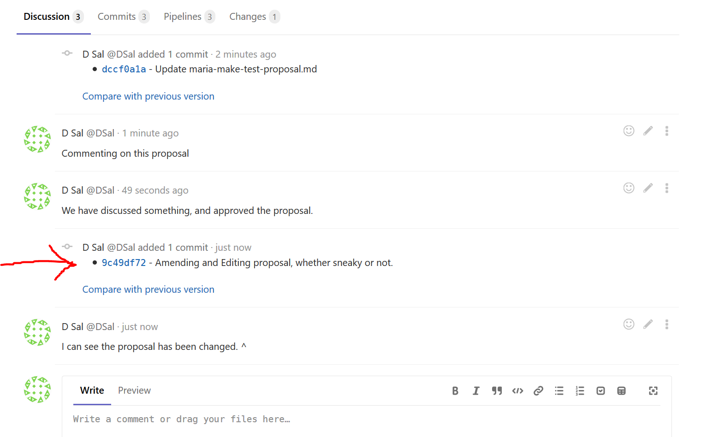

import { Image } from "astro:assets";

import newBranchSuccess from "@/assets/how-to/new-branch-success.png";
import CodeSample from "@/components/pages/how-to-ccs/CodeSample.astro";
import Field from "@/components/pages/how-to-ccs/Field.astro";
import AccordionItem from "@/components/ui/accordion/AccordionItem.astro";
import Callout from "@/components/ui/Callout.astro";
import Grid from "@/components/ui/layout/Grid.astro";
import PageSection from "@/components/ui/layout/PageSection.astro";
import ProseLink from "@/components/ui/ProseLink.astro";
import SectionTabs from "@/components/ui/tabs/SectionTabs.astro";

export const components = { a: ProseLink };

**Note:** Read the [What is the CCS and What Are Its Rules and Expectations](/what-is-ccs/#ccs-rules-and-expectations) page before continuing!

<section aria-label="Instructions">
<SectionTabs tabs={[{ label: "Step by step" }, { label: "Quickstart" }]}>
<Fragment slot="panel-0">
<AccordionItem title="1. Gitlab" variant="card" headingLevel={2} open>

**You will only have to do this step once! If you make future proposals, you can skip to Step 2.**

First things first, you're going to need an account on [Monero's Gitlab instance.](https://repo.getmonero.org) Following the provided link will bring to the sign up page. Register for an account (use a strong password), and then navigate to the [CCS Proposals repo](https://repo.getmonero.org/monero-project/ccs-proposals). Click the "Fork" button and select your name on the subsequent screen.



You should see a blue success bar, along with your new repository.



</AccordionItem>
<AccordionItem title="2. Branches" variant="card" headingLevel={2} open>

If you're not familiar with git, then this next step might not make a lot of sense to you, but it is common and recommended practice for users of git and Gitlab. Basically, just do this, even if you don't understand it. It makes the maintainer's lives a lot simpler.

Click on Branches.



Then click on New Branch.



Fill in the "Branch Name" on the next screen by naming it something similar to your proposal. No spaces are allowed though. Leave the other field as is (it should say "Master") and click Create Branch. You should be taken back to your repository, but now on the new branch, as evidenced by seeing the name of your new branch on the screen. A screenshot is provided below to show where you would see it.

<Image
  id="new-branch-success"
  src={newBranchSuccess}
  alt="Hooray! You're on your new branch."
/>

</AccordionItem>
<AccordionItem title="3. Make the proposal file" variant="card" headingLevel={2} open>

From here, you're going to click on the + button near the top center of your screen, and click "New File" on the subsequent dropdown.



On this new screen, fill in the File Name field with a descriptive title that includes your name, or online handle, is relevant to your proposal, and ends in `.md`. As an example, if Diego "rehrar" Salazar was to make a proposal asking for funding so I can make videos for Monero, I might title the file `rehrar-make-videos-for-monero.md`.

</AccordionItem>
<AccordionItem title="4. Front matter" variant="card" headingLevel={2} open>

Before you begin writing your proposal, however, you must copy the following template and paste it onto the top of your file:

<Grid minWidth="18rem" gap="sm">
<CodeSample label="Template">

```
---
layout: fr
title:
author:
date:
amount:
milestones:
  - name:
    funds:
    done:
    status: unfinished
  - name:
    funds:
    done:
    status: unfinished
payouts:
  - date:
    amount:
  - date:
    amount:
---
```

</CodeSample>
<CodeSample label="Example">

```
---
layout: fr
title: Make a Monero Spaceship
author: somekid
date: January 31, 2019
amount: 10000
milestones:
  - name: Milestone 1 - Purchase the parts
    funds: 30% (3000 XMR)
    done:
    status: unfinished
  - name: Milestone 2 - Assemble the spaceship
    funds: 50% (5000 XMR)
    done:
    status: unfinished
  - name: Milestone 3 - Throw a big party
    funds: 20% (2000 XMR)
    done:
    status: unfinished
payouts:
  - date:
    amount:
  - date:
    amount:
  - date:
    amount:
---

The proposal will be written here.
```

</CodeSample>
</Grid>

Fill this template out as follows:

<dl>
<Field name="layout:">Do NOT touch this field.</Field>
<Field name="title:">Fill this in with a descriptive title of what your proposal wants to accomplish. Copy this field into a notepad program, as the EXACT title will be used in Step 6.</Field>
<Field name="author:">Put your name or handle here.</Field>
<Field name="date:">Put the date you are proposing and submitting this to the community in the following format: `January 31, 2019`.</Field>
<Field name="amount:">Put the amount of Monero you are requesting to complete this.</Field>
<Field name="milestones:">

Do not put anything after Milestones directly, but rather the fields that follow it. Copy and paste from one dash (`-`) to the other, depending on how many milestones your proposal will take. So if you have four milestones, you should put the following:

```
milestones:
  - name:
    funds:
    done:
    status: unfinished
  - name:
    funds:
    done:
    status: unfinished
  - name:
    funds:
    done:
    status: unfinished
  - name:
    funds:
    done:
    status: unfinished
```

<Callout>
  EXACT FORMATTING MUST BE PRESERVED WITH THE SPACING. Otherwise the proposal
  will not work. The dashes must be two spaces from the left margin.
</Callout>

Fill in the `name:` field with the name of the Milestone (for example: Complete Video 1), and the `funds:` field with the amount of Monero you expect to receive for completing the milestones. Do not touch the `done:` or `status:` fields. Repeat until all the `name:` and `funds:` fields are filled in. If this confuses you, see the example above for all of this correctly filled out.

</Field>
<Field name="payouts:">Copy and paste the same amount of variables under payouts that you have under milestones. If you have three milestones, you should have three sets `date:` and `amount:` variables underneath `payouts:`. Do not fill in these fields.</Field>
</dl>

</AccordionItem>
<AccordionItem title="5. Writing your proposal" variant="card" headingLevel={2} open>

NOW you can put your proposal beneath the front matter (underneath the last three dashes). When writing the proposal remember to include:

- What the proposal is about.
- Who will complete the proposal?
- Why it is important for Monero and the community.
- Your milestones and projected timeline
- An expiration date for the proposal. If it's not funded or finished by a certain time, the funds can be released to other proposals or the General Fund. This keeps things moving along in a timely fashion.

It is recommended that after your proposal is written, you copy and paste it (minus the front matter from step 4) and paste it into a notepad. This will be used in step 6.

After all of this is done, click the green Commit Changes button at the bottom.

</AccordionItem>
<AccordionItem title="6. Make a Merge Request" variant="card" headingLevel={2} open>

After you click Commit Changes, you will be taken to your newly created file in the new branch of your repository. You will see a bar at the top that lets you know the creation of your file has been successful. You will also see a notification that your new branch can make a Merge Request.

Click on the blue button in the upper right to start this process.



You will see a screen with a few things to fill out. In the Title field, put the same title that you used in the front matter of your proposal. In the Description text box, paste in the proposal EXACTLY AS IT APPEARS IN YOUR .md file, minus the front matter. If you followed Step 5, you should have it in a notepad program of some sort.



After this is done, scroll down, and click the green Submit Merge Request button at the bottom left of the page. You should be taken to the Merge Request page for your proposal.

</AccordionItem>
<AccordionItem title="7. You’re done. Now go drum up some support." variant="card" headingLevel={2} open>

Good job on getting all the way here. When you finish, the community will be discussing your proposal on the merge request itself. If you want to weigh in on the discussion, feel free. It will be up to you to get people to support your proposal, both for it to be moved to the Funding Required stage, and also while its awaiting donations. Best of luck, and thank you so much for contributing to Monero. We, the community, really appreciate it.

</AccordionItem>
</Fragment>
<Fragment slot="panel-1">

1. Register for an account on [Monero's Gitlab instance.](https://repo.getmonero.org) and fork the [CCS Proposals repository](https://repo.getmonero.org/monero-project/ccs-proposals)
2. Make a new branch, named similarly to your proposal
3. Add a new `.md` document, and title it similarly to the title of your proposal with your name or handle in the file name.
4. Use the template provided below for the front matter, and place it at the top of your proposal. You are responsible for adding the appropriate amount of milestones, with an equal number of payouts below the milestones.

<Callout>
  FORMATTING MUST BE PRESERVED, OR THE PROPOSAL WILL NOT WORK! Do NOT fill in
  the `done:` variable under `milestones:`, and do NOT fill in anything under
  `payouts:` besides making sure the number matches the number of milestones.
</Callout>

```
---
layout: fr
title:
author:
date:
amount:
milestones:
  - name:
    funds:
    done:
    status: unfinished
  - name:
    funds:
    done:
    status: unfinished
payouts:
  - date:
    amount:
  - date:
    amount:
---
```

5. Underneath the front matter, write the rest of your proposal. Be sure to include what the proposal is about, who will be completing it, why it is important for the community, the milestones and projected timeline, and an expiration date for your proposal.
6. Save, commit, and make a Merge Request to the repo. Your MR title must be descriptive and relevant to your proposal. The MR description should be copy/pasted from the proposal contents for easy viewing (front matter excluded).
7. You're done. Go start letting people know about your proposal.

</Fragment>
</SectionTabs>
</section>

<PageSection title="Editing or Amending a Proposal" anchorId="editing-or-amending-a-proposal">

Often times, through community critique and feedback, it is necessary to edit a proposal after the Merge Request has already been submitted. This can be done in the following way.

### Navigate to your CCS Proposals repository

From the homepage of repo.getmonero.org, once you're logged in, you should see a list of your repositories. Find your copy of `CCS Proposals` and click on it.

### Branches and files

Locate the dropdown with all of your active branches, click it, and select the branch on which your proposal was made.



Once you are on the page with the correct branch, as evidenced by the name of the branch showing (see [the last screenshot in step 2](#new-branch-success) of the step-by-step instruction to see where) find and select the file of your proposal (this is why descriptive branch and file names are important).

### Editing the file

Once you are on the page of your file, on the upper right corner should be an Edit button.



Select this and you should be taken to the editing screen. Amend the proposal as needed (remember to edit the front matter too if any of those variables are changing), and press the green Commit Changes button at the bottom.

<Callout>
  Warning! Not only the changes but THE FACT that you made changes will be
  visible to EVERYONE! You CANNOT stealth edit your proposal. This is good for
  transparency. See the screenshot below.
</Callout>



</PageSection>
